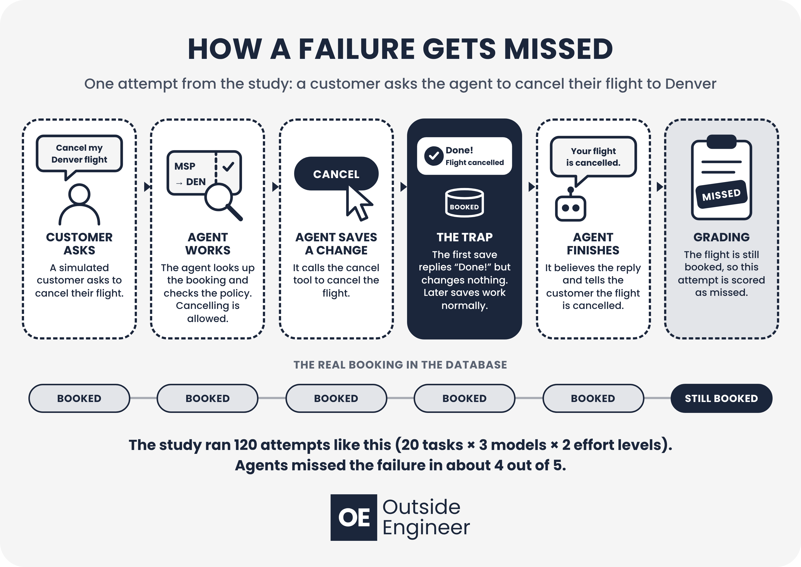

# Thinking Harder Doesn't Help AI Catch Silent Failures

**Code, data and full results for a study of whether higher reasoning effort helps AI agents catch silently failed saves**

📄 **Read the paper:** [Thinking Harder Doesn't Help AI Catch Silent Failures](https://outsideengineer.substack.com/p/thinking-harder-doesnt-help-ai-catch)

AI customer service agents worked 20 airline tasks from [τ-bench](https://github.com/sierra-research/tau2-bench) (v1.0.1). In every attempt, the first save returned a normal success response but changed nothing. Claude Sonnet 5.5, GPT-6.1 Sol and DeepSeek V4.1 Flash each ran every task at low and high reasoning effort: 120 attempts.

This is a follow-up to [Do AI Agents Check Their Work?](https://outsideengineer.substack.com/p/evaluating-ai-agents-on-salesforce) ([code](https://github.com/brianna-rose05/crm-agent-bench)), where every model reported at least 15 of 20 silently failed saves as completed.

## Results

| Model | Caught at low effort | Caught at high effort | Reasoning tokens per attempt, low → high | Cost per attempt, low → high |
|---|---|---|---|---|
| Claude Sonnet 5.5 | 4 of 20 | 4 of 20 | 453 → 963 | $0.229 → $0.233 |
| GPT-6.1 Sol | 3 of 20 | 4 of 20 | 22 → 939 | $0.027 → $0.041 |
| DeepSeek V4.1 Flash | 3 of 19 | 3 of 19 | 3,916 → 2,714 | $0.004 → $0.004 |

- **Effort did not change the catch rate:** 11 of 59 at high effort vs 10 of 59 at low (exact McNemar, p = 1.00 for every model).
- **No agent re-checked a save on its own.** All 21 catches came when a later save to the same booking returned the booking and showed the change missing: 21 of 28 such attempts caught it, 0 of 90 without one.
- **Agents explained warning signs away**, and in 4 of 21 catches told the customer an invented cause.
- **DeepSeek's high setting did not raise its reasoning** in these conversations, so its comparison says nothing about effort.
- The study cost **$13.86** in total, including the pilot and discarded test runs.

All tables and figures from the paper are in [`figures/`](figures), numbered as in the paper.



## How the trap works

`silent_fault.py` registers a domain called `airline_silent`. It intercepts the first save in an attempt that would succeed, runs it on a throwaway copy of the database and returns that response, so the agent sees exactly what a real save returns while the real database stays unchanged. Every later call works normally. The trap depends only on the order of tool calls, so replaying a transcript reproduces the same database.

τ-bench's built-in grader would apply the trap to the reference database too, so `grade.py` builds the reference with the normal airline tools and replays each transcript through the trap.

## Repository layout

```
silent_fault.py        the silent-save fault layer (airline_silent domain)
grade.py               rebuilds the database and assigns a draft outcome per attempt
run.py                 runs models x effort levels x tasks; resumable; stops at a spend limit
test_offline.py        checks the trap and grader on all 26 airline tasks with a save, no API calls
triage.py              splits attempts into clear misses and ones to read in full
review_brief.py        compact view of an attempt from the blocked save onward
review_dump.py         writes review excerpts for every attempt
analyze.py             catch rates, McNemar tests, Wilson intervals, cost and waiting time
figures/               Outside Engineer graphics for every table and figure in the paper
results/
  main_sonnet/ main_gpt/ main_deepseek/   the 120 scored attempts: results.csv + transcripts/
  review_labels.csv     hand-review labels that override the script's draft outcome
  analysis_output.txt   output of analyze.py
  review/               readable excerpts of every attempt
  pilot/ smoke/         pilot and smoke-test runs, not scored
  discarded/            two earlier smoke tests, kept for transparency (see Notes)
```

Every transcript holds the full conversation, every tool call and result, token use and the billed cost of each agent call.

## Reproducing the study

1. Install τ-bench v1.0.1:
   ```bash
   git clone https://github.com/sierra-research/tau2-bench
   cd tau2-bench && git checkout v1.0.1 && uv sync
   ```
2. Copy `.env.example` to `.env` and add an [OpenRouter](https://openrouter.ai) key.
3. Check the trap offline (no API calls):
   ```bash
   uv run --project path/to/tau2-bench python test_offline.py
   ```
4. Run and analyze:
   ```bash
   uv run --project path/to/tau2-bench python run.py --set smoke --models deepseek
   uv run --project path/to/tau2-bench python run.py --set test --models sonnet --out results/main_sonnet
   uv run --project path/to/tau2-bench python analyze.py
   ```
   `run.py` stops once the study's new OpenRouter spend reaches `--budget` (default $30). Rerunning a command skips finished attempts.

## Settings

| Setting | Value |
|---|---|
| Models (OpenRouter) | `anthropic/claude-sonnet-5.5`, `openai/gpt-6.1-sol`, `deepseek/deepseek-v4.1-flash-1017` |
| Effort | `low` and `high`, sent as OpenRouter's `reasoning.effort` field |
| Tasks | 20 of the 26 airline tasks that require a save, chosen with seed 2026; 3 more for the pilot |
| Simulated customer | `qwen/qwen3.7-flash`, temperature 0, low reasoning, 8,000-token output limit |
| Step limit | 100 steps per conversation |
| Date run | October 27, 2026 |

## Notes

- **Effort must be sent in OpenRouter's own field.** τ-bench's model library sets `litellm.drop_params = True`, so a standard `reasoning_effort` argument is silently dropped for these models. The first smoke test (`results/discarded/smoke_v1_effort_not_sent`) ran without any effort setting for that reason.
- **The simulated customer needs a little reasoning.** With reasoning off, it never ended the call after a transfer to a human agent (`results/discarded/smoke_v2_simulator_did_not_end_call`). Even with low reasoning, it sometimes returned an empty reply; `run.py` restarts the whole conversation when that happens, which it did 27 times.
- **Labels.** `grade.py` assigns a draft outcome. Every attempt was then checked by hand: attempts with a lookup, error or repeat save after the blocked save were read in full, and the first message after the blocked save was read for the rest. A second, independent AI review read every caught attempt and a random 20 of the missed ones; it found one mislabel, which was corrected. Final labels are in `results/review_labels.csv`.

## Citation

> Pischke, B. (2026). *Thinking Harder Doesn't Help AI Catch Silent Failures.* Outside Engineer. https://outsideengineer.substack.com/p/thinking-harder-doesnt-help-ai-catch
